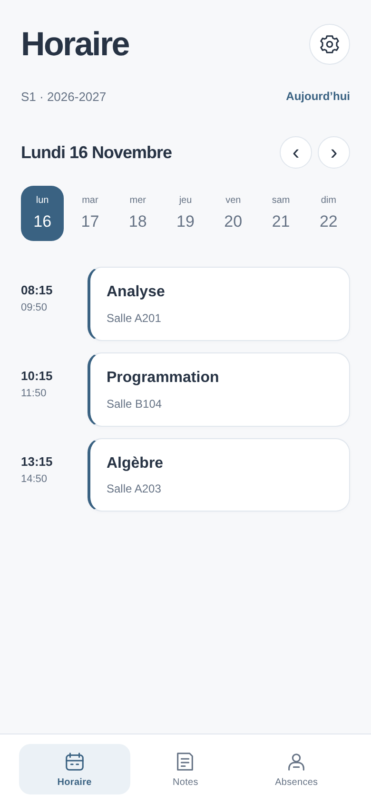
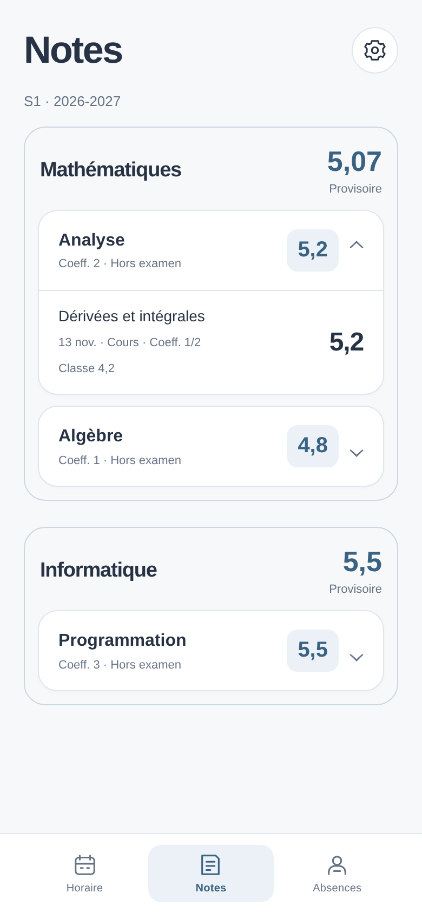
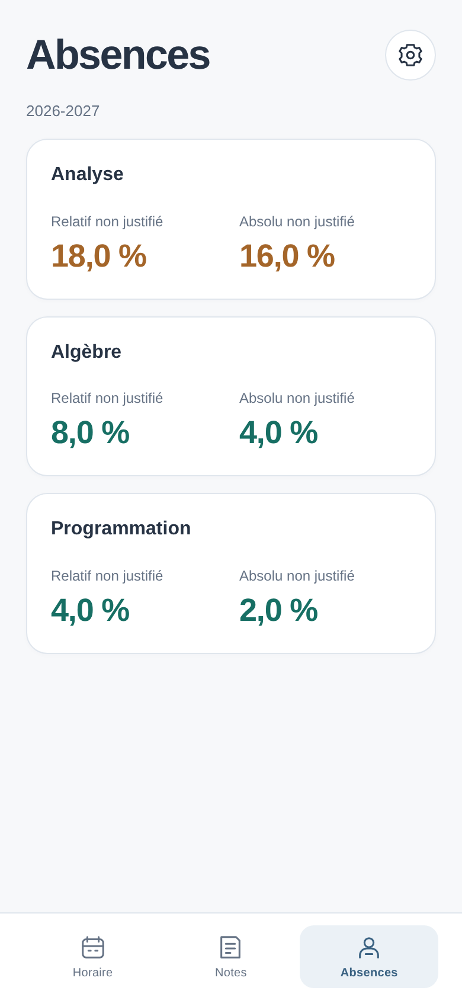

  

<h1 align="center">Mini GAPS</h1>

<strong>Votre semestre, en un coup d’œil.</strong>

Notes, absences et horaire dans une application légère, pensée pour le téléphone.

  <a href="#découvrir-lapplication">Découvrir</a> ·
  <a href="#installer-mini-gaps">Installer</a> ·
  <a href="docs/deploiement.md">Déployer</a>

## Moins de clics, plus de clarté

Mini GAPS transforme les informations du portail GAPS de la HEIG-VD en un espace
personnel facile à consulter. Ouvrez votre horaire, retrouvez vos notes par module
et repérez vos taux d’absences depuis trois onglets, sans vous reconnecter à chaque
ouverture.

Une fois installée sur l’écran d’accueil, la PWA s’ouvre comme une application.
Son interface bleu minimal laisse la place aux informations qui comptent.

## Découvrir l’application

<table>
  <tr>
    <th>Votre journée</th>
    <th>Vos résultats</th>
    <th>Vos absences</th>
  </tr>
  <tr>
    <td></td>
    <td></td>
    <td></td>
  </tr>
</table>

*Captures de la vraie interface exécutée dans Chromium en simulation mobile,
avec une API locale et des données entièrement fictives. Ce sont des captures
navigateur, sans retouche du contenu ni maquettes générées.*

### L’horaire dès l’ouverture

Les cours, les heures et les salles sont réunis dans une vue quotidienne.
Glissez horizontalement pour changer de jour, ou sur la barre des jours pour
changer de semaine.

### Les notes, à votre rythme

Les branches sont regroupées par module et repliées pour garder une vue d’ensemble.
Dépliez une branche pour retrouver ses épreuves, coefficients et moyennes de classe.
Les pastilles signalent les notes nouvelles ou corrigées que vous n’avez pas encore
lues. Les moyennes de modules sont pondérées sur les branches disponibles et
clairement indiquées comme **provisoires**.

### Les absences qui se lisent vite

Chaque branche affiche ses taux relatif et absolu non justifiés. Les taux absolus
les plus élevés apparaissent en premier ; les couleurs permettent de les repérer
rapidement : vert sous 15 %, orange de 15 à moins de 30 %, rouge dès 30 %.

## Une application qui suit votre quotidien

- **Installable sur iPhone** : accès depuis l’écran d’accueil, interface adaptée au téléphone.
- **Dernières données hors connexion** : consultez la copie conservée sur votre appareil.
- **Accès privé persistant** : association initiale par code, session par appareil et révocation côté serveur.
- **Actualisation discrète** : lecture à l’ouverture et au retour au premier plan ; tirez vers le bas pour relire les données.
- **Notifications de notes** : Web Push prévu pour les publications et corrections, avec la matière et le type de changement, sans afficher la valeur de la note.

Le serveur récupère les informations toutes les dix minutes, de 06h00 à 23h50,
heure suisse, même quand l’application est fermée. Les consultations de l’interface
ne lancent pas de récupération sur GAPS. En cas d’échec, les dernières données
valides restent disponibles et leur état est signalé dans l’application.

**Les notifications nécessitent une configuration Web Push, une PWA installée sur
l’écran d’accueil et votre autorisation sur iPhone compatible. La réception réelle
sur iOS reste à valider.** Le délai dépend de la récupération périodique puis du
transport Push ; la livraison n’est pas instantanée ni garantie.

## Vos informations restent privées

Les identifiants scolaires sont utilisés uniquement par le scraper côté serveur.
Ils ne sont jamais transmis au navigateur. L’API exige un appareil associé pour
servir les données et la déconnexion efface la copie locale.

La session serveur est valable cinq ans et peut être révoquée. Le navigateur peut
toutefois supprimer ses cookies ou son stockage et demander une nouvelle
association. La copie hors connexion repose sur la protection de votre appareil ;
une révocation distante ne peut pas effacer immédiatement un appareil déconnecté.

## Installer Mini GAPS

Mini GAPS est une application **à héberger soi-même**, avec Docker et Docker Compose.
Elle utilise deux conteneurs et une base SQLite persistante, sans navigateur
lourd dans l’image de production.

1. Préparez le `.env` privé à partir de [`.env.example`](.env.example), vos dossiers de données et leurs permissions.
2. Configurez `DEV=false` et votre origine publique HTTPS dans `APP_ORIGIN`.
3. Suivez le [guide de déploiement](docs/deploiement.md) pour construire, synchroniser et configurer les notifications.
4. Ouvrez l’adresse HTTPS sur votre iPhone, ajoutez la PWA à l’écran d’accueil et associez-la avec le code généré sur votre serveur.

Pour essayer le projet sur votre ordinateur, consultez le
[guide de développement Docker](docs/developpement.md).

## Pour aller plus loin

| Besoin | Documentation |
| --- | --- |
| Lancer et développer avec Docker | [Développement](docs/developpement.md) |
| Installer, sauvegarder et mettre à jour | [Déploiement](docs/deploiement.md) |
| Comprendre la récupération des données | [Scraper](docs/scraper.md) |
| Consulter les routes et l’authentification | [API privée](docs/api.md) |
| Comprendre le hors connexion et les gestes | [PWA](docs/pwa.md) |
| Configurer les notifications | [Web Push](docs/push.md) |
| Voir les vérifications et limites | [Validation](docs/validation.md) |
| Reproduire les captures de démonstration | [Captures](docs/screenshots/README.md) |
